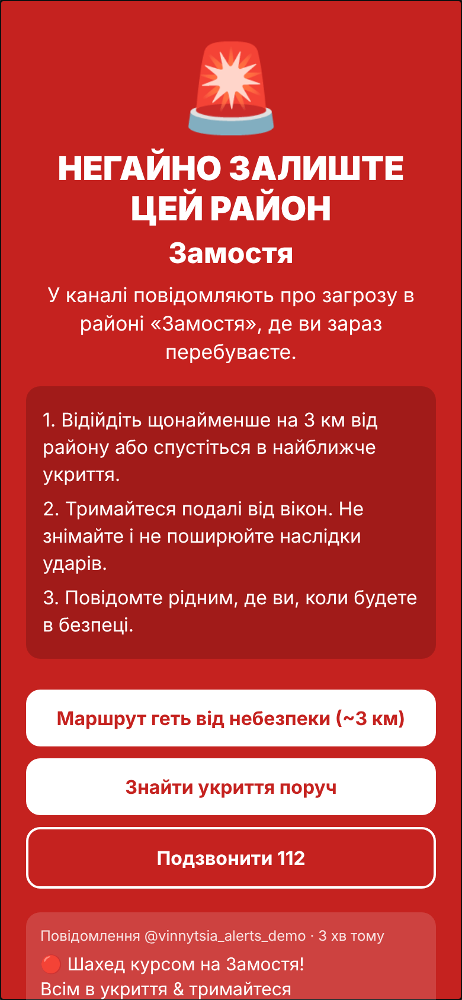
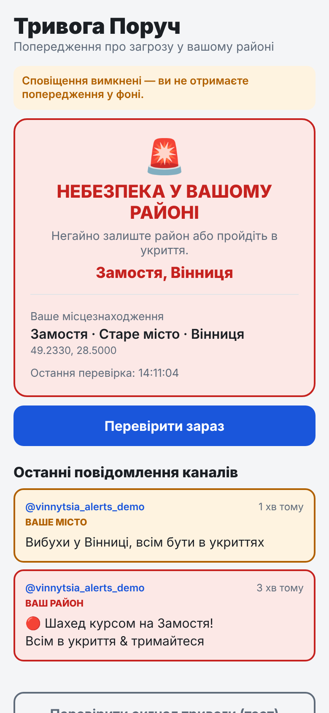
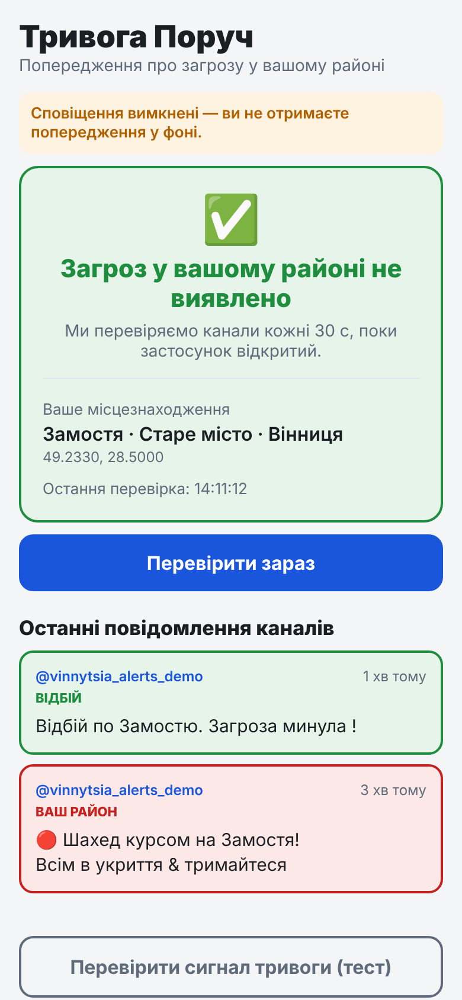

# Тривога Поруч / Alert Nearby (POC)

A mobile app for iOS and Android. It reads 1–2 **public Telegram channels** with local alerts, compares the districts named in each post with the **user's current location**, and when the user's district is named it shows a full-screen warning: **leave the area now**.

The first target is **Vinnytsia, Ukraine**.

| Alert screen | Home (danger) | Home (all clear) |
|---|---|---|
|  |  |  |

(The screenshots come from a browser preview with a mocked feed. The "notifications off" banner appears only in the browser.)

➡️ **To publish to the App Store and Google Play, see [DEPLOY.md](DEPLOY.md).**

## How it works

```
Telegram channel ──(https://t.me/s/<channel>, every 30 s while the app is open)──▶ parser
                                                                               │
Phone GPS ──▶ which zones am I in? (Замостя, Вінниця …) ──────────────────────▶ matcher
                                                                               │
              newest post naming my district, < 30 min old, not "відбій" ──▶ 🚨 alert
```

- **No server, no Telegram account, no API keys.** The app reads the channel's public web preview `t.me/s/<channel>`. That page shows the latest ~20 posts.
- **Zones** are circles (centre + radius) with keyword lists. For example, Замостя has the keyword `замост*`, which matches Замостя, Замості and Замостю. They live in `src/zones/vinnytsia.ts`.
- Alert levels:
  - 🔴 **DANGER**: your *district* is named. The app shows a full-screen red alert, vibrates, and sends a notification. The alert screen has these buttons:
    - *Route away* (~3 km walking route pointing away from the district)
    - *Find shelter nearby* (searches "укриття" in Maps)
    - *Call 112*
    - *Open the post in Telegram*
  - 🟠 **CAUTION**: only your *city* is named ("Вибухи у Вінниці"). Oblast-wide posts ("Вінницька область") are ignored on purpose because they are too frequent.
  - 🟢 **SAFE**: nothing relevant, or the newest post about your district is an all-clear ("відбій", "загроза минула").
- A threat expires after `ALERT_TTL_MINUTES` (30 by default) unless a newer post mentions the district again.
- **Background.** The OS wakes the app roughly every 15 minutes or more (best effort). It uses the last known location and sends a local notification. The fastest warnings come while the app is open.
- Location **never leaves the phone**. The app asks only for "while using" location permission.

## Configuration

Everything is in **`src/config.ts`**:

| Setting | What it does |
|---|---|
| `CHANNELS` | Telegram usernames to read (public channels only). Currently `vinnytsiappo`. Alternatively set the env var `EXPO_PUBLIC_TG_CHANNELS=a,b` at build time. |
| `POLL_INTERVAL_SECONDS` | Check interval while the app is open (30). |
| `ALERT_TTL_MINUTES` | How long a threat post stays active (30). |
| `REQUIRE_THREAT_KEYWORD` | `false`: any post naming your district triggers an alert (safest). `true`: the post must also contain a threat word. |
| `ALL_CLEAR_KEYWORDS`, `THREAT_KEYWORDS` | Word lists. A trailing `*` matches a word prefix. |
| `ZONES` | The district list. Swap the file to support another city. |

### Tuning zones (do this before release)

The centres and radii in `src/zones/vinnytsia.ts` are **approximate**.

1. Read 20–30 real posts from your channels and note how they spell the districts, including case endings ("на Вишеньці", "по Замостю").
2. Add any missing spellings to `keywords`. Use `word*` for a prefix and a plain word for an exact match. Use exact forms when a prefix would hit other things: Пирогово uses exact forms so that it doesn't match "вул. Пирогова".
3. Check each `center` in Google Maps (right-click → coordinates) and set `radiusKm` so the circle covers the district.
4. Run `npm test`, and add a test case for any tricky spelling.

## Try it in your browser (fastest)

```bash
npm install
npm run web
```

This starts a small local Telegram proxy on port 8787 (browsers can't read t.me directly because of CORS) and the Expo dev server. Open the address it prints, normally http://localhost:8081.

- To use your real location, allow location in the browser.
- To pretend you're in a district, add coordinates to the URL. For example, http://localhost:8081/?lat=49.233&lng=28.5 puts you in Замостя. You can also use Chrome DevTools → ⋮ → More tools → Sensors → Location.
- **Sound alerts in the browser:** click **"🔊 Увімкнути звук тривоги і сповіщення"** once; browsers only allow sound after a click. Allow notifications when asked. From then on, a threat in your district plays a repeating siren until you press "Я в безпеці", and shows a desktop notification.
- For browser alerts to work, keep the tab open (it can be in the background) and keep the computer awake. A hidden tab is checked about once a minute instead of every 30 s.

## Run locally

```bash
npm install
npm test          # parser / matcher / geo / alert-logic tests
npm run typecheck
npx expo start    # scan the QR code with the Expo Go app (background checks don't run in Expo Go)
```

For a full native test build, run `npx eas-cli@latest build --platform android --profile preview`. That gives you an installable APK; see DEPLOY.md.

## Project layout

```
App.tsx                      home screen
index.ts                     entry point (registers the background task)
src/config.ts                ← edit this
src/zones/vinnytsia.ts       district zones + keywords
src/lib/telegram.ts          fetch + parse t.me/s/<channel>
src/lib/text.ts              Ukrainian-aware keyword matching
src/lib/evaluate.ts          core decision logic (pure, unit-tested)
src/lib/monitor.ts           one check: fetch → evaluate → notify
src/lib/background.ts        background task (expo-background-task)
src/lib/notifications.ts     local notifications (high-priority Android channel)
src/hooks/useMonitor.ts      location, polling, alert state for the UI
src/components/              StatusCard, AlertOverlay, MessageList, PermissionScreen
docs/privacy-policy.html     host on GitHub Pages (required by both stores)
__tests__/                   Jest tests + an HTML fixture of a t.me/s page
```

## Known POC limitations / next steps

1. **Background delivery is not real-time.** iOS and Android decide when background tasks run (15+ minutes, sometimes much longer). For real-time warnings when the app is closed, add a small server (for example a Cloudflare Worker cron job every minute) that reads the channels and sends **push notifications** to devices subscribed to a zone. Devices would share only the zone ID, never coordinates.
2. **iOS Critical Alerts** (sound even in silent mode) need a special entitlement that you request from Apple.
3. `t.me/s/` works only for **public** channels with the web preview enabled, and it depends on Telegram's HTML layout. If Telegram changes that layout, update `parseChannelHtml` and the fixture.
4. Keyword matching is simple. Posts with unusual wording or typos can be missed, so tune the keyword lists against real posts.
5. **This is not an official warning system.** The app says so on screen. Users should always follow the official air-raid alarm.
